<picture>
  <source media="(prefers-color-scheme: dark)" srcset="assets/header-dark.svg">
  
</picture>

# John Kikiiyin Aboderin

I'm Kiki. I train models that look at things, like handwriting and tomato leaves, and then build the software that puts them in front of people.

Most of my work happens in Python and Jupyter notebooks. When a model is ready, I wrap it in an API and a web front end so someone without a notebook can use it.

[Repositories](https://github.com/Kiki544?tab=repositories) · [EliteClub test site](https://elite-club-nine.vercel.app)

## 01 / Models that see

### [Optical Character Recognition](https://github.com/Kiki544/OpticalCharacterRecognition)

Written notes shouldn't stay stuck on paper.

A TensorFlow model that reads written characters and returns digital text. Convolutional layers find the strokes and an LSTM reads them in order. I score it by edit distance, which counts how many characters it gets wrong, not just whether a whole word is right.

<picture>
  <source media="(prefers-color-scheme: dark)" srcset="assets/fig-ocr-dark.svg">
  
</picture>

### [Tomato Disease Detection](https://github.com/Kiki544/TomatoDisease_Detection)

One leaf photo, one diagnosis.

Upload a photo of a tomato leaf and the model names what it sees: bacterial spot, early blight, yellow leaf curl virus, mosaic virus, or a healthy leaf. The Keras model sits behind a FastAPI service with a React front end, ready to deploy on Render.

<picture>
  <source media="(prefers-color-scheme: dark)" srcset="assets/fig-leaf-dark.svg">
  
</picture>

Leaf photo: [Clemson University – USDA Cooperative Extension Slide Series, Bugwood.org](https://commons.wikimedia.org/wiki/File:Alternaria_solani_-_leaf_lesions.jpg), licensed [CC BY 3.0 US](https://creativecommons.org/licenses/by/3.0/us/), cropped. The probabilities are an illustration, not a live prediction.

## 02 / Software people use

### [EliteClub test site](https://github.com/Kiki544/EliteClub)

A test site for a community club, [running on Vercel](https://elite-club-nine.vercel.app).

Programmes, news, a gallery, donations, a members area and an admin page. Built with Next.js, TypeScript, Tailwind and Motion.

### [ProxyShop v3](https://github.com/Kiki544/ProxyshopV3)

A shop that lives inside Telegram.

A Python bot that sells proxies. It takes card payments through Stripe and USDT through NOWPayments, sends receipts and expiry reminders, tracks referrals, and gives the admin a stats dashboard. It runs on Railway.

Also on the workbench

- [Mother of the Redeemer church site](https://github.com/Kiki544/MotherOfTheRedeemer-church-): a Django website with a photo gallery.
- [Result Checker](https://github.com/Kiki544/RESULT-CHECKER-OOP): a PyQt desktop app on SQLite for checking university results.

## 03 / The work, over time

If my career were a model, this would be its training curve. Loss drops with every public contribution, flat stretches are plateaus, and each dot is a project.

<picture>
  <source media="(prefers-color-scheme: dark)" srcset="assets/fig-curve-dark.svg">
  
</picture>

<picture>
  <source media="(prefers-color-scheme: dark)" srcset="assets/activity-dark.svg">
  
</picture>

Every square is a day of public contributions on GitHub. The outlined square is the busiest day.

<picture>
  <source media="(prefers-color-scheme: dark)" srcset="assets/stats-dark.svg">
  
</picture>

How this graph is made

[`scripts/build_activity.py`](scripts/build_activity.py) reads my public contribution calendar and draws it as an SVG, in light and dark versions. [`scripts/build_stats.py`](scripts/build_stats.py) works out the streaks from the same calendar and adds up languages across my own public repositories. [`scripts/build_curve.py`](scripts/build_curve.py) turns the running total of contributions into the training curve. A GitHub Action reruns it every Monday, so the snapshot date on the graph shows how fresh it is. Private work isn't counted.

## 04 / Model card

Every model I ship comes with a model card. It seemed fair to write one for myself.

| Model | Kiki, also released as John Kikiiyin Aboderin |
|---|---|
| **Architecture** | One human, fine-tuned on Python |
| **Training data** | Jupyter notebooks, Keras docs, and a lot of late-night debugging |
| **Inputs** | Leaf photos, handwriting, and problems that don't have an app yet |
| **Outputs** | Models, the APIs that serve them, and the websites people actually click |
| **Best at** | Taking an idea from a notebook all the way to something you can use |
| **Known limitations** | Sometimes overfits to a fun side project |
| **Status** | Still training. New versions ship regularly. |
